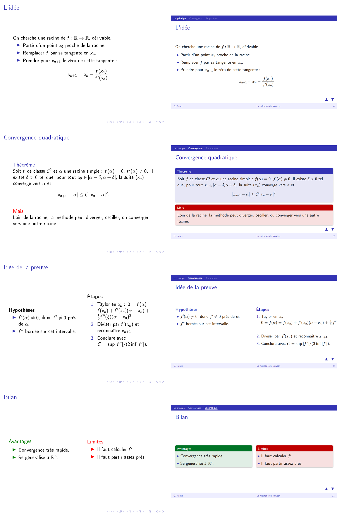

# Transition.js

**Slides in HTML and CSS, written the way you write beamer.**

**▶ See it running: [pantz.pages.math.cnrs.fr/transitionjs](https://pantz.pages.math.cnrs.fr/transitionjs/)** — every example below opens in the browser, nothing to install.

Transition.js is a 500-line JavaScript file with no dependency. It does one thing: at each step of your talk, it toggles a few classes and increments a few CSS variables. Everything you see — the next slide sliding in, a bullet appearing, a formula turning red — is CSS. If you can write a beamer talk, you already know how to write one with Transition.js; if you know some CSS, there is no effect you cannot build.

<p align="center"></p>

*Left: beamer (Warsaw theme). Right: the same talk in Transition.js — [open it](https://pantz.pages.math.cnrs.fr/transitionjs/examples/newton/newton.html), then compare [`newton.tex`](examples/newton/newton.tex) and [`newton.html`](examples/newton/newton.html) side by side.*

## Try it in thirty seconds

Copy `transition.js`, `transition.css` and the `themes/` folder next to this file:

```html
<!DOCTYPE html>
<html lang="en">
<head>
  <meta charset="UTF-8">
  <link rel="stylesheet" href="transition.css">
  <link rel="stylesheet" href="themes/base.css">
  <link rel="stylesheet" href="themes/layouts.css">
  <link rel="stylesheet" href="themes/beamer.css">
</head>
<body>
  <div id="slides">

    <section>
      <div class="center"><hgroup><h1>My talk</h1><h4>A subtitle</h4></hgroup></div>
    </section>

    <h2>First part</h2>

    <section>
      <h3>A slide</h3>
      <div>
        <ul class="steps">
          <li>This appears first,</li>
          <li>then this,</li>
          <li>then this.</li>
        </ul>
        <div class="block alert pause"><h5>Careful</h5><p>Blocks, columns and tables come with the layouts.</p></div>
      </div>
    </section>

  </div>
  <script src="transition.js"></script>
  <script>TransitionJS.init();</script>
</body>
</html>
```

Open it in a browser. Space, Enter, arrows, PageUp/PageDown, swipe. Escape shows the whole deck; click a slide to jump to it. The URL follows the current slide, so `talk.html#first-part` opens the talk there.

## Beamer speakers, this is for you

| beamer | Transition.js |
|---|---|
| `\begin{frame}{Title} … \end{frame}` | `<section><h3>Title</h3><div>…</div></section>` |
| `\section{Part}` | `<h2>Part</h2>` |
| `\begin{itemize}[<+->]` | `<ul class="steps">` |
| `\pause` | `class="pause"` on the element that appears |
| `\begin{block}{Theorem}` | `<div class="block"><h5>Theorem</h5>…</div>` |
| `\begin{alertblock}`, `\begin{exampleblock}` | `class="block alert"`, `class="block example"` |
| `\begin{columns}` | `<div class="columns"><div>…</div><div>…</div></div>` |
| `\tableofcontents` | `<nav class="toc"></nav>` + `tableofcontents.js` |
| headline with the current section | `<nav id="toc"></nav>` — see below |
| `\only<2>{…}`, `\alert<3>{…}`, anything | one `data-fragments` attribute — see below |
| `$…$`, `\[…\]` | the same, through [MathJax](https://www.mathjax.org/) |

Beamer gives you a fixed set of overlay commands. Transition.js gives you one mechanism that subsumes them all:

```html
<p class="hidden" data-fragments="{hidden} 0.5s">appears at the next step, fading in over half a second</p>
<p data-fragments="{big} +1{small} 2s">grows at one step, shrinks at the next</p>
<div data-fragments="+0[frac]{red}">…and at the same step, the fraction with id "frac" turns red</div>
```

A fragment says *when* (next step, `+n`, `#n`), *on what* (`[id]`, `[slide]`, itself), *which classes or CSS variables* to toggle, and *how long* the transition takes. The engine keeps them in document order, so you never number anything. Going backwards reverses them.

## The headline follows the talk

The one thing beamer does that HTML slide libraries usually give up on: a persistent table of contents where visited, current and upcoming parts look different. Transition.js does it without a line of JavaScript beyond `++`: each part title increments a CSS variable on the headline, each entry knows its own index, and the theme compares the two in CSS.

```js
TransitionJS.tableOfContents({ target: '#toc, .toc' });
TransitionJS.init({
  rules: [{ selector: '#slides > h2:not(:first-child)',
            fragments: '[slides]{--shift++} 0.6s +0[toc]{--current++} 0.6s' }],
});
```

## What's in the box

```
transition.js        the engine (no dependency)
transition.css       layout of the deck: column, row or fade mode, overview grid
themes/base.css      slide structure: titles on top, content below
themes/layouts.css   columns, centring, blocks, lists, tables, figures — for people who do not want to write CSS
themes/beamer.css    the look of beamer, with the persistent headline
themes/sarah.css     a free-form theme: absolute positioning, big type, effects
tableofcontents.js   tables of contents, ids for the URL, indices for the headline
graph.js             function graphs in SVG, animatable
poll.js, poll.css    live polls on a slide (deck side)
server/              the poll server: Node, one file, deploys on PLMshift
examples/            minimal, beamer, tour (every feature), fade, newton (beamer side by side), poll
GUIDE.md             the full guide (in French for now) — [online](https://pantz.pages.math.cnrs.fr/transitionjs/guide.html)
test/                logic tests under jsdom, screenshots under headless Chromium
```

## Why HTML, and why no PDF export

Because a PDF cannot play a video, run an animation, let you type a number and see a curve move, or take a vote. Transition.js started as a way to put video in a talk, back when Linux PDF viewers could not; what it turned into is a deck where anything a browser can do is a slide. Beamer compatibility is the on-ramp, not the destination — and that is why there is no export to PDF: a talk that exports to PDF was not using the browser.

**Live polls** are the first thing built on that idea: a question on a slide, students answer from their phones through a QR code, the bars grow on the slide as votes come in, then the answer lights up. `poll.js` and `poll.css` do the deck side without creating a single DOM node (votes become CSS variables); a fifty-line server in `server/` does the rest, and deploys on PLMshift in three commands. See [`examples/poll.html`](examples/poll.html) and [`server/README.md`](server/README.md).

## Why not reveal.js / impress.js / …?

They are excellent and much bigger. Transition.js has no build step, no plugin system, no configuration object with forty keys, and no opinion about how your slides look. The engine fits in one file you can read in a coffee break, and every effect is a class you can inspect in the browser's developer tools. It was written by a mathematician who wanted to keep giving talks the way beamer had taught him, but in a browser, with real fonts, video, interactive figures and links.

## License

MIT. Use it, share it, propose themes or improvements.
